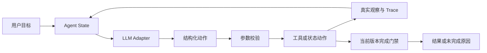

# 方案与工程约束

## 决策与执行分工



`AgentRunner` 不按时长自动删镜头，也不自动固定重试流程。每步将目标、完整动作目录、当前稿、素材、检查历史、上一观察、剩余步数交给 Adapter。LiveAdapter 通过 OpenAI-compatible Chat Completions 发出请求，解析一个动作后才执行；下一步包含真实工具观察。`draft_script` 的实际文本也是这次模型动作的一部分。

Runtime 对非法动作、参数、工具异常和完成前提进行确定性限制。这些门禁属于工程校验，不被包装成模型规划。`MockAdapter` 从明确的测试动作列表取下一项；其修订与重试均预设，不具有模型自主性。

## 文件职责

| 文件 | 职责 |
|---|---|
| `src/agent.py` | 有上限的动作循环、状态动作、完成门禁、结果组装 |
| `src/llm_adapter.py` | 真实 HTTP 请求、JSON 解析、模型元数据与异常；隔离 Mock |
| `src/schemas.py` | 严格输入/动作/脚本/素材类型，拒绝额外字段及模型填写估时 |
| `src/tools.py` | 三个业务工具、Registry、参数校验与异常安全执行 |
| `src/state.py` | 目标、检索快照、稿件、历史检查、错误、状态及版本指纹 |
| `src/tracing.py` | run_id、追加事件、最终快照与配置密钥脱敏 |
| `src/mock_fixtures.py` | 公开标记的离线动作序列，仅用于工程验证 |
| `scripts/` | 实际运行、保存测试输出、验证行为和审计交付文件 |

## 模型协议

```json
{"action":"search_assets","arguments":{"query":"轻剪字幕"},"reason_summary":"需要获得产品事实依据"}
```

该片段只说明协议，不是一次执行记录。动作包括检索、写稿/改稿、估时、查规则、请求补充、完成、停止。每个动作的参数 schema 随请求发送给模型；`estimate_duration`、`check_brand_rules`、`finish` 仅接受 `{}`，模型不能指定另一份脚本或虚增目标时长。

使用 `json_object` 兼容较多服务商；本地 Pydantic 继续核验结构，拒绝重复 JSON 键、未知动作、额外字段、NaN、代码围栏和截断响应。[OpenAI 官方文档](https://developers.openai.com/api/docs/guides/structured-outputs)区分 JSON 模式与严格结构约束：可解析 JSON 本身不足以保证业务 schema。

HTTP 默认超时 60 秒，可配置，禁止自动重定向携带凭证。无静默模型替换或降级。认证/路径/明显请求配置错误直接 incomplete；其余调用异常反馈为观察并计入上限。模型拒绝、截断、非法响应不算成功动作。尚未对任何真实服务商执行互操作验证。

## 三个工具

**检索。** 基于合成素材的明确关键词，忽略大小写，匹配 query 中的目录关键词或可选 keywords，并可按 asset_ids 过滤。分数为匹配关键词数，排序稳定，返回匹配解释、事实、原文与 found/no_results。关键词是完整子串匹配，无法覆盖全部中文同义词；允许模型改写查询，涉及无法确认的主题关联时请求澄清。

**估时。** 文本时间 = 中文及其他非拉丁文字数/4.5 + 英文词数/2.5 + 数字组数/2 + 标点数×0.18。逐镜时间 = 向上取到 0.01 秒的 `max(旁白时间, 字幕阅读时间, 2秒) + 0.35秒`，总时长为各镜之和。参数来自品牌配置并必须合法。数字被当作一个朗读单位的近似，实际读法可能更长；字幕与口播假设同时出现。没有硬编码案例总秒数。

**事实/品牌。** 核验实际已检索的来源，不接受仅存在于全目录但未检索的事实。验证 asset_id、fact_id、evidence_text、claim_text、原文包含关系及逐镜引用；检查所有可见字段和旁白、禁词、无据数字承诺、未覆盖自由文本、待解决风险。允许的量化规格必须也有完整原文（如合成杯子的 500 毫升），不是禁止所有数字。更换源数据后旧检索快照不能继续验证。

事实检查采用保守的完整原文覆盖策略。批准短语是人工应审查的可信非事实配置，不允许模型动态扩充白名单。未知改写不会因为“看起来合理”就通过。程序不能替代完整语义蕴含判断或版权审核。

## 版本与完成门禁

版本标识是排序规范 JSON 的 SHA-256，覆盖脚本全部内容、完整用户输入、素材目录、检索素材和品牌规则。`script_revision` 是另一个逐次提交序号；相同稿再次显式提交也清空旧检查。相同未变稿重复调用检查会真实重算、记录相同内容指纹，不伪造新版本。

改稿清空两项当前检查，保留历史；替换用户输入或素材同样失效，替换素材还清除检索缓存。完成时重新计算指纹，可防止绕开更新方法直接修改对象后复用旧检查。所有业务工具错误（含参数拒绝）清空两项当前检查，之后必须重新验证。

`finish` 只在必要输入齐全、已有稿件和已检索素材、当前版本的估时与规则检查均 `passed=true` 时进入 completed。最终时长由工具结果填写；旧版本的结果不写入当前输出。模型不能自行填写 status 或 estimated_seconds。

默认 max_steps=12，可设置 1–100。每次失败模型调用也消耗一步，防止非法响应无限循环。达到上限返回 incomplete，携带已执行步骤、原因、最后观察。request_info 为 needs_info；模型主动 stop 为 failed；启动错误为 incomplete 并给出 failure_phase。

## Trace 与数据边界

每步记录结构化动作、参数、公开理由摘要、完整工具观察、错误、前后版本和下一步真实动作。Live 额外记录无鉴权头的请求、模型返回文本、响应 ID、模型名、usage 和 HTTP 状态，不记录服务商私有 reasoning 字段。JSONL 在每步追加，最终 JSON 采用临时文件替换写入，防止部分 JSON。

配置中的密钥和鉴权字段会被脱敏，但日志仍包含用户输入、脚本和素材；真实业务数据需在授权范围内保存。当前夹具全部是合成内容。模型上下文随 max_steps 有界增长，未实现大规模语料检索、上下文压缩、持久会话恢复或并发运行协调。

选择 Pydantic/httpx/dotenv/pytest，未引入 Agent 框架、数据库、UI、多 Agent、视频渲染或部署。Python 3.11+ 是代码目标，本次实际执行环境以测试报告为准。
