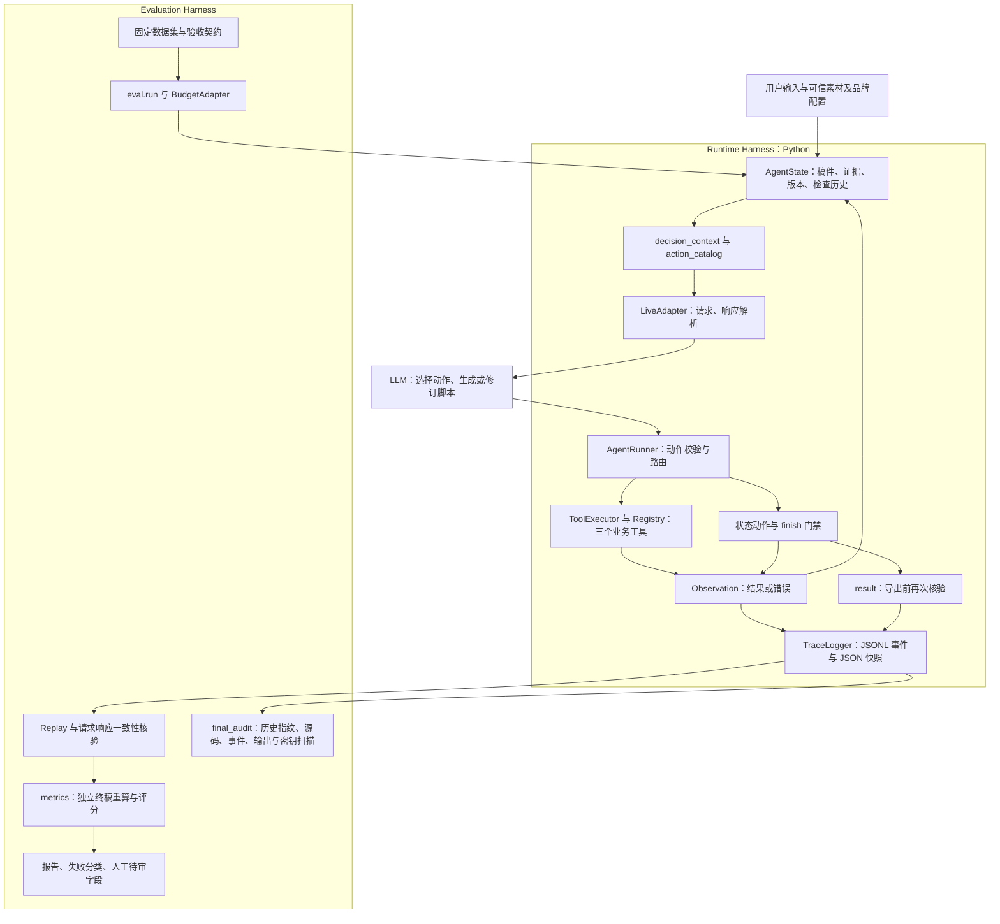
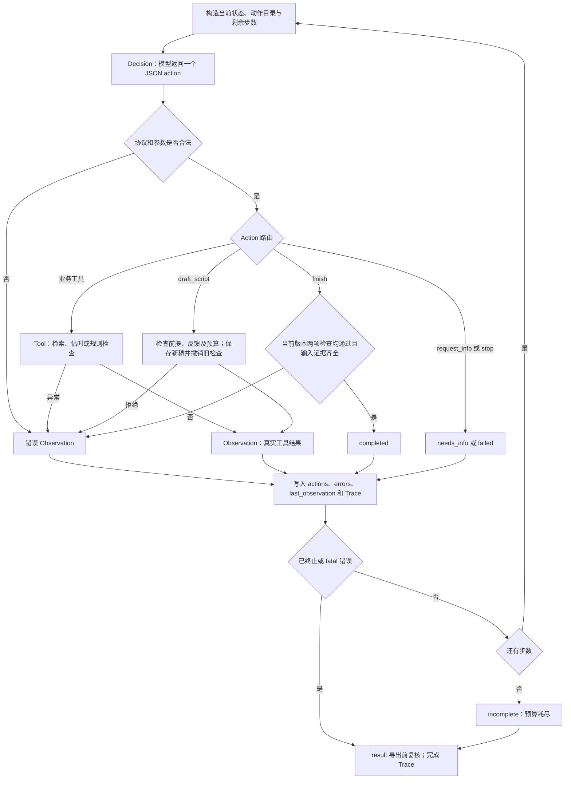

# 现有 Agent Harness 架构与执行证据

本文基于当前工作区真实代码整理已有架构（2026-10-28），不代表新实现了一套 Harness。Runtime Harness 是模型外部负责上下文、执行、状态、约束和记录的 Python 代码；Evaluation Harness 是围绕运行记录进行独立重算、评分和审计的代码。两者已有实现，本次仅补充说明。

## 1. 架构与职责边界



模型决定检索词、工具调用顺序、稿件内容、删改方案、重试、请求补充或停止。Python 不自动缩稿，也不因估时失败直接安排重试或固定修订链。提示词中的工作建议影响模型选择，但只有代码校验才是确定性约束。

七个 action 不等于七个业务工具：`search_assets`、`estimate_duration`、`check_brand_rules` 经过 `ToolExecutor`；`draft_script`、`request_info`、`finish`、`stop` 由 Runner 处理。写稿内容来自模型，Runner 只校验并保存。`MockAdapter` 使用预设动作序列，仅证明工程路径，不证明自主决策。

## 2. Action → Tool → Observation → Decision



图中 draft 的反馈与四步预算门禁适用于当前默认 `policy_version=2`。工具 `ok=true` 仅表示执行成功，`passed=false` 仍是有效观察，例如超时；检索 `no_results` 也不是工具异常。真正的 `ok=false` 进入错误历史。模型下一次请求读取真实观察，再选择动作。

## 3. 机制与实际代码映射

下表以文件和符号定位，避免源码行号变化导致定位失效。

| 机制 | 代码位置 | 已实现的职责与边界 |
|---|---|---|
| Model Decision | [llm_adapter.py](../src/llm_adapter.py)：`LiveAdapter.decide`、`parse_action`、`Decision` | 每步发送 system prompt 和包含 state/action_catalog 的 user 消息；解析模型返回的一个 JSON 动作。使用 Chat Completions 内容协议，并非原生 function-call API。拒绝重复键、非法常量、未知动作等；公开 `reason_summary` 不是内部思维链。 |
| Tool Routing / Execution | [agent.py](../src/agent.py)：`_execute_action`；[tools.py](../src/tools.py)：`ToolRegistry`、`default_registry`、`ToolExecutor.execute` | Runner 校验动作参数；工具边界再校验。注册表提供三个确定性函数，执行器负责传入可信状态、保存检查及异常转观察。 |
| Context Construction | [state.py](../src/state.py)：`context`；[agent.py](../src/agent.py)：`decision_context`；[schemas.py](../src/schemas.py)：`action_catalog` | 包含用户输入、已检索证据、规则、当前稿、完整动作/检查/错误历史、上一观察、finish blockers、预算。v2 增加当前版本检查、待检查项、最低完成步数；成功检查观察附带 `revision_feedback`。每轮重新组装，没有摘要压缩。 |
| State and Version Management | [state.py](../src/state.py)：`script_version`、`update_script`、`invalidate`、`replace_input`、`replace_assets` | SHA-256 覆盖稿件、输入、素材目录、检索素材和规则；revision 是提交序号。更新稿件撤销两项当前检查但保留历史；替换素材还清空检索。指纹动态计算，使直接修改对象也无法复用旧版本通过结果。 |
| Guardrails | [schemas.py](../src/schemas.py)：`StrictModel`、`ACTION_ARGUMENTS`；[agent.py](../src/agent.py)：`_execute_action`、`result`；[state.py](../src/state.py)：`finish_errors` | 严格类型和额外字段拒绝；估时/规则/finish 仅接受空参数，模型不能填结果或换检查对象。缺必要输入、缺检索证据不能写稿；finish 和导出均验证当前版本两项通过。v2 拒绝相同稿和无新增成功工具反馈的连续改稿。 |
| 事实与时长门禁 | [tools.py](../src/tools.py)：`check_brand_rules`、`estimate_duration`、`speech_seconds` | 逐镜原文引用、来源、主题关键词、批准文案、禁词与风险校验；估时取旁白、字幕、最短镜头的最大值并加转场。只证明保守字符串支持与工程估时，不证明完整语义真实性或真人时长。 |
| Execution Budget | [agent.py](../src/agent.py)：`__init__`、`run`、`_execute_action`；[llm_adapter.py](../src/llm_adapter.py)：`LiveAdapter`；[eval/run.py](../eval/run.py)：`BudgetAdapter.decide` | Runtime 默认12步、允许1–100，失败也消耗一步；v2 改稿至少需剩余4步供改稿、双检和finish。HTTP 默认60秒，可配置至300秒。评测另有整批请求及每例工具次数上限，不是所有 Runner 都具备的预算。 |
| Error Handling | [llm_adapter.py](../src/llm_adapter.py)：`ModelError`、`LiveAdapter.decide`；[agent.py](../src/agent.py)：`run`；[tools.py](../src/tools.py)：`execute` | 400/401/403/404及重定向为 fatal，进入 incomplete；其他模型/传输/解析错误反馈后可继续。业务工具异常或非法参数使当前检查失效。普通模型错误本身不统一清空检查。无隐藏自动重试、指数退避或模型降级；下一动作仍由模型选择。 |
| Tracing and Replay | [tracing.py](../src/tracing.py)：`TraceLogger`；[replay.py](../scripts/replay.py)：`replay_trace`；[evidence.py](../scripts/evidence.py)：`inspect_live_calls`、`inspect_trace_events`；[eval/audit.py](../eval/audit.py)：`audit_error_run` | 追加事件、最终快照、配置/数据快照、请求响应、动作和版本；脱敏配置密钥，拒绝同名run_id。Replay 离线重放已记录动作并重算上下文、工具与结果；模型错误记录使用 error-aware 路径。 |
| Evaluation | [eval/dataset.py](../eval/dataset.py)：`load_dataset`；[eval/metrics.py](../eval/metrics.py)：`evaluate`、`aggregate`；[eval/report.py](../eval/report.py)：`render`；[final_audit.py](../scripts/final_audit.py)：`audit_trace`、`run_audit` | 数据契约、独立终稿重算、行为证据、比例分母、失败分类、人工待审字段和交付审计。不能将模型自报 completed 直接当成功评分。 |

`update_script` 本身即使接收相同稿也会递增revision并失效检查；当前默认 v2 Runner 在调用它之前拒绝相同稿。两层行为不能混为一谈。`FeedbackRequired` 允许检索或任一检查的成功反馈，不代表必须先通过两项检查才能改稿。

终止语义：`request_info → needs_info`，主动 `stop → failed`，fatal模型错误/步数耗尽/改稿预算不足 → `incomplete`，通过finish → `completed`。`run` 只接受 pending 状态，不支持把一次已结束的状态继续运行。

## 4. Evaluation Harness 与 Runtime 的分界

Runtime 管一次运行能否安全结束；评测在其外部决定案例是否满足验收。`eval.run` 默认仅校验数据集，不调用模型；显式 `--live` 才调用配置模型，无Mock降级。每批新建时间戳/UUID目录，保留数据、环境及源码指纹、逐例Trace、输出、partial结果和报告。

`BudgetAdapter` 在下一次模型请求之前检查整批请求数及当前案例已调用的业务工具数；失败工具动作也计入工具次数，传输失败也计入请求数。达到工具上限时，即使模型本可能下一步finish，也不会额外放宽。没有token硬上限、金额预算或全流程墙钟超时保证；usage为服务商返回的记录。

`evaluate` 重新检查终稿、检查动作与HTTP记录一致性，并离线Replay。例如超时案例不仅要求completed，还要求先触发超时、真实改稿并在新版本通过；工具故障案例要观察到注入失败和后续重试。无素材案例要有不同查询及明确补充请求。`aggregate` 保留计划/执行/跳过的数量，零分母返回null，不制造100%成功。

工具选择适当性和无据声明率明确是自动代理指标；`human_review` 默认 `NOT VERIFIED`，创作质量、完整语义蕴含和拒绝解释仍需人工评审。数据集一旦用于优化，就不能继续称为全新盲测，参见[最终评估](../final-evaluation.md)。[rescore.py](../eval/rescore.py)读取历史结果并新建评分目录、记录评分源码指纹，不重新调用模型；[decision_compare.py](../eval/decision_compare.py)可离线比较批次及首稿，但其输出参数没有独占写保护，调用者仍需选择新路径。

`final_audit`核对JSON/JSONL/输出、历史文件摘要、受保护运行代码、可选pytest报告及密钥扫描。启动失败只做事件一致性检查，不能称为可执行成功Replay。`replay_trace`不重新让模型作决定，不是会话恢复；模型错误使用`audit_error_run`核对记录的错误及后继状态，不能重现远端故障本身。任意runtime_error也没有通用完整重放保证。日志落盘失败没有独立恢复事务。

## 5. 真实模型 Trace：正常修订路径

证据：[JSON](../examples/traces/live_overtime_tight_round1.json)、[JSONL](../examples/traces/live_overtime_tight_round1.jsonl)、[最终输出](../examples/outputs/live_overtime_tight_round1.json)。run_id=`live_overtime_tight_round1`，`mode=live`、`execution_kind=real_api`、模型`deepseek-flash`，7次已记录真实响应，max_steps=12，无故障注入。

这条路径的“正常”指业务超时反馈驱动的正常修订，不是首稿即通过。用户要求先交包含三项事实的完整稿，再按4秒上限修订。以下v1/v2指稿件revision；本节及下一节的历史Trace都未记录`decision_policy_version`，Replay按旧策略1解释，不能据此证明当前策略2新增的`decision_progress`、`revision_feedback`及四步/重复稿门禁。

| 步骤 | 模型动作与选择 | 真实观察 | 当时已有的Harness约束及后继 |
|---|---|---|---|
| 1 | search_assets，query为“自动字幕 时间线剪辑 竖屏导出” | found，返回素材事实 | 只有实际检索证据进入状态；模型随后写稿。 |
| 2 | draft_script，提交三镜首稿 | revision=1，版本前缀`e336f333` | 保存稿件，旧检查失效；模型选择估时。 |
| 3 | estimate_duration，空参数 | 7.64秒，目标4秒，超3.64秒，passed=false | 工具成功执行但业务不通过；不能finish。下一请求携带此观察。 |
| 4 | draft_script，模型删减到自动字幕单镜 | revision=2，版本前缀`7e34debd`，checks_invalidated=true | Python没有代写或删镜；新版必须重新验证。 |
| 5 | estimate_duration | 2.35秒，passed=true，新版本 | 只满足时长门禁；仍缺规则检查。 |
| 6 | check_brand_rules | passed=true，violations=[]，新版本 | 两项当前检查齐全，模型选择finish。 |
| 7 | finish | completed | Runner核验当前版本后导出；结果revision=2、2.35秒。 |

可核对`steps[2].observation.total_estimated_seconds=7.64`，`steps[3].arguments.script.storyboard`只有一镜，`steps[4].observation.total_estimated_seconds=2.35`。模型公开理由明确引用超时观察；证据还包括实际不同稿件、版本变化及双检，不能只凭理由摘要判断修订成功。

## 6. 真实模型 Trace：失败恢复路径

证据：[JSON](../examples/traces/live_tool_failure_round1.json)、[JSONL](../examples/traces/live_tool_failure_round1.jsonl)、[最终输出](../examples/outputs/live_tool_failure_round1.json)。run_id=`live_tool_failure_round1`，live/real_api、`deepseek-flash`，8次已记录真实响应，max_steps=12。`configuration.fault_injection_once=["estimate_duration"]`：故障由测试配置明确注入，后续重试与改稿由真实模型选择；这不是生产偶发故障，也不是Mock预设重试。

| 步骤 | 模型动作与选择 | 真实观察 | Harness约束及后继 |
|---|---|---|---|
| 1 | search_assets，“轻剪字幕” | found | 保存检索证据。 |
| 2 | draft_script，七镜稿 | revision=1，版本前缀`b04acb8b` | 写稿后检查失效。 |
| 3 | estimate_duration | ok=false，RuntimeError：Injected one-time tool failure | 执行器移除一次性注入标记并清空两项当前检查；Runner记录错误及last_observation，消耗一步。 |
| 4 | 模型再次选择estimate_duration | 30.91秒，目标30秒，超0.91秒 | 没有自动重试；本次成功执行仍未通过时长门禁。 |
| 5 | draft_script，删重复收尾并精简为六镜 | revision=2，版本前缀`769ddfe5` | 改稿撤销旧检查；重新验证新版本。 |
| 6 | estimate_duration | 23.18秒，passed=true | 规则门禁仍待检查。 |
| 7 | check_brand_rules | passed=true，violations=[] | 新版本双检通过。 |
| 8 | finish | completed，revision=2 | 最终输出23.18秒；errors保留第3步故障，不因恢复而抹除。 |

可核对`steps[2].observation.error`、`steps[3].action`与该步请求state中的`last_observation`，以及`final_result.errors`。本次离线核验应同时检查模型响应动作、下一请求反馈、确定性工具重算、事件及输出一致性；`mode=live`标签本身不足以证明真实调用。两条记录只能证明这些已保存路径，不能推导出所有故障均能恢复或模型质量稳定；本地HTTP记录也不是独立服务商证明。

## 7. 已实现能力之外的边界

| 能力 | 当前状态 |
|---|---|
| 单次运行内记忆 | 已实现：State保存检索、稿件及历史，随上下文回传。 |
| 长期记忆、跨会话学习、持久会话恢复 | 未实现。Trace文件是审计证据，不是可续跑checkpoint或长期记忆。 |
| 上下文压缩、摘要、token截断策略 | 未实现。步数有限不等于上下文token大小有硬保证。 |
| 沙箱隔离、进程级工具权限控制 | 未实现。工具在本Python进程运行；注册表和schema不是操作系统隔离。 |
| 复杂审批、人工批准后自动续跑 | 未实现。request_info会终止本次运行，人工待审字段不是审批执行引擎。 |
| 自动退避、服务商故障转移、分布式调度、多Agent | 未实现。当前为原生单Agent循环。 |
| 向量或语义检索、完整语义事实判断 | 未实现。当前是目录关键词检索和原文覆盖校验。 |
| 全面提示注入防护 | 未实现可证明的全面防护。提示词将输入视作数据，schema与完成门禁约束输出，但不能据此宣称全面防注入。 |
| 防篡改存证、全量隐私脱敏 | 未实现。指纹和一致性审计有用但不是签名存证；日志仍包含业务输入、素材和脚本。 |

## 8. 文档核验与回归

相关测试映射：[test_adapter.py](../tests/test_adapter.py)验证协议与观察回传；[test_validation.py](../tests/test_validation.py)验证版本与参数边界；[test_failures.py](../tests/test_failures.py)验证异常和失效；[test_decision_optimization.py](../tests/test_decision_optimization.py)验证当前策略预算及反馈；[test_trace_replay.py](../tests/test_trace_replay.py)、[test_eval.py](../tests/test_eval.py)、[test_final_audit.py](../tests/test_final_audit.py)验证复算、评分和审计。测试夹具不计为真实模型证据。

在项目根目录执行现有测试，不使用会覆盖历史报告的重跑脚本：

```powershell
.\.venv\Scripts\python.exe -m pytest tests -q
```

两条Trace可通过`scripts.final_audit.audit_trace(path, root)`只读核验；不调用模型、不写历史证据。文档路径检查应解析本文、README和方案文档的本地Markdown链接，确认目标存在；同时比较源码、测试、scripts、eval、examples的修改前后文件摘要。

本次实测结果（2026-10-28）：完整pytest **158 passed**；三个文档的**82个本地链接全部有效**；上述两条Trace分别复算**7步、8步**，请求响应一致性、事件及输出核验均通过，**新增模型调用0次**。修改前后核对src、scripts、tests、eval、examples下998个既有文件的SHA-256，全部未变；未覆盖历史Trace或评测结果。此次只修改本文、README和方案文档，保留工作区原有未提交修改，未commit或push。
